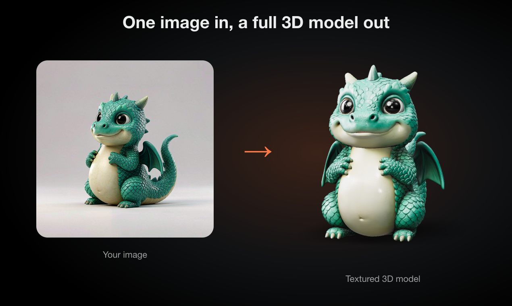

# 3DLoom sample models

Textured 3D models generated with [3DLoom](https://3dloom.com/image-to-3d), each made from a single AI-generated image of an original object (one from four views). They are free to use under CC BY 4.0. Use them to test importers, viewers, game engines or slicers, or to see what AI image-to-3D output looks like before you try it on your own images.

| Model | Made from | File |
|---|---|---|
| Baby dragon figurine | One image | [`models/dragon.glb`](models/dragon.glb) |
| Brass diving helmet | One image | [`models/helmet.glb`](models/helmet.glb) |
| Fabric speaker | One image | [`models/speaker.glb`](models/speaker.glb) |
| Mushroom cottage | One image | [`models/mushroom.glb`](models/mushroom.glb) |
| Mushroom cottage | Four views (front, left, back, right) | [`models/mushroom-4v.glb`](models/mushroom-4v.glb) |

## What's in each file

- Plain glTF binary (`.glb`) with no compression extensions, so Blender, Godot, three.js and most viewers open it directly. Unity needs the free glTFast package.
- About 50,000 triangles with 2048 px textures baked from the original. These are the lighter download size; the original Ultra output has roughly 1.4–2 million triangles and full PBR maps.
- Models are about one unit tall and centered on the origin, Y up.

## How they were made

1. An image of one object on a plain background was generated with an image model.
2. The image was uploaded to [3DLoom's image to 3D generator](https://3dloom.com/image-to-3d) on the Ultra engine. Generation took about two to three minutes per model.
3. The 50k version was downloaded from the model page. The same page also offers FBX, OBJ, USDZ, PLY, and a closed STL or 3MF for 3D printing.

For the four-view mushroom, the front, left, back and right views were uploaded together, so the sides and back follow the drawings instead of being inferred.

## Known limits

- The back of single-image models is inferred, so it can differ from what you imagined.
- Thin parts and small details (straps, coins, text) may merge or disappear.
- These are textured meshes with triangles only, no quads, rigging or UV layout meant for hand editing.

## Open and convert them online

These free browser tools from 3DLoom work on the files here. Nothing is uploaded; the files stay on your computer.

- [GLB viewer](https://3dloom.com/glb-viewer): inspect the mesh, textures and triangle count.
- [GLB to STL](https://3dloom.com/convert/glb-to-stl): a closed mesh for slicers.
- [GLB to 3MF](https://3dloom.com/convert/glb-to-3mf): keeps part colors for multi-color printers such as Bambu Lab and Prusa.
- [GLB to OBJ](https://3dloom.com/convert/glb-to-obj) and [GLB to FBX](https://3dloom.com/convert/glb-to-fbx): for Blender, Maya, Unity and other tools.

If you print in color, the [3MF viewer](https://3dloom.com/3mf-viewer) shows painted colors, [Split 3MF by color](https://3dloom.com/split-3mf) gives one part per filament, and [3MF to OBJ](https://3dloom.com/convert/3mf-to-obj) keeps the painted colors as materials.

## License

The models and images in this repository are licensed under [CC BY 4.0](LICENSE). Credit "3DLoom (3dloom.com)" when you share them.
